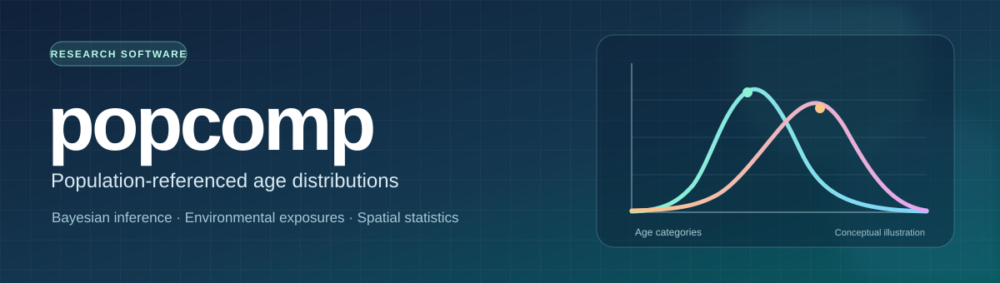
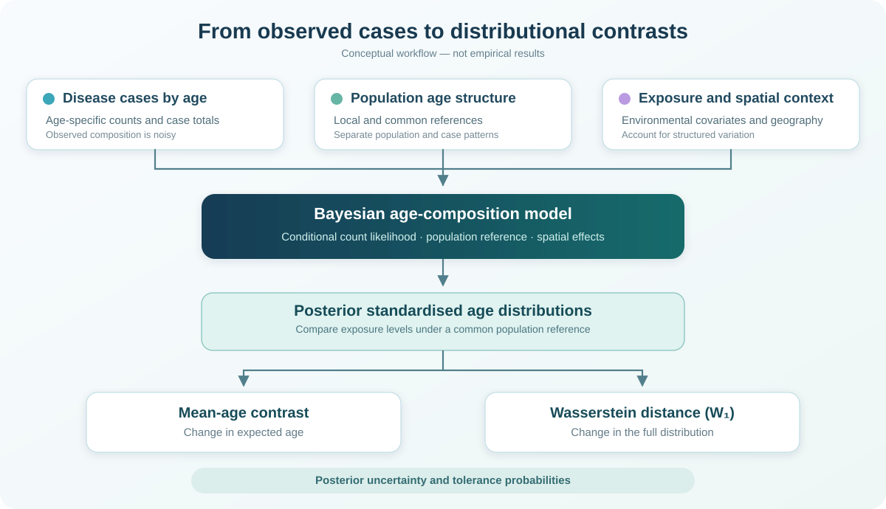

# popcomp

**Bayesian modelling of population-referenced disease age distributions**

`popcomp` is a research R package for studying how environmental exposures relate to the **age distribution of disease cases**. It accounts for differences in population age structure, small case counts, spatial dependence, and uncertainty in distributional comparisons.

> **Status:** Active research development. The package is not yet a validated public release.

## Why popcomp?

The observed age composition of disease cases is not directly comparable across areas with different population age structures. Comparisons based only on empirical distributions can also be unstable when the number of cases is small, and spatially structured exposures may be confounded with unobserved geographic variation.

The framework models **age-specific disease rates** and uses Bayesian posterior inference to compare age distributions under a **common population reference**.

## Framework

The workflow above is a **conceptual illustration, not an empirical result**.

For area $i$, time $t$, and age group $k$, let $C_{itk}$ be the observed case count and $n_{it} = \sum_{k=1}^{K} C_{itk}$ the total number of cases. Conditional on $n_{it}$, the case composition is modelled through

$$
(C_{it1},\ldots,C_{itK})\mid n_{it}
\sim \operatorname{Multinomial}(n_{it},\boldsymbol p_{it}).
$$

The model distinguishes the underlying case-age distribution $\boldsymbol p_{it}$ from its noisy empirical estimate. A unit-specific population reference $\boldsymbol q_i$ accounts for local age structure; a common reference $\boldsymbol q^*$ supports standardised comparisons across exposure levels.

Spatial effects and relevant environmental covariates are incorporated into the Bayesian model.

## Main inferential summaries

- **Mean-age contrast:** The posterior change in expected case age under two exposure conditions.
- **Wasserstein distance ($W_1$):** The posterior difference between the full age distributions, beyond their means.
- **Tolerance probabilities:** Posterior probabilities that a contrast falls within a scientifically meaningful tolerance range.

These are posterior functionals of modelled age distributions; they are not treated as error-free distances computed from sparse empirical counts.

## Research application

The methodology is being developed and evaluated for an application involving **malaria in the Brazilian Amazon**, with environmental exposures and geographic heterogeneity.

Simulation work investigates calibration, numerical accuracy, spatial confounding, and robustness to modelling assumptions.

## Implementation and reproducibility

The project is implemented in **R**, with Bayesian computational methods including **Integrated Nested Laplace Approximation (INLA)**.

The planned reproducibility materials include model specifications, prior definitions, simulation scripts, tests, and code for the empirical application. Installation instructions and documented user-facing examples will be added after the package interface and release checks are finalised.

## Validation status

The software is undergoing numerical accuracy, prior sensitivity, and reproducibility assessment. Passing regression checks alone should not be interpreted as establishing full inferential accuracy.

